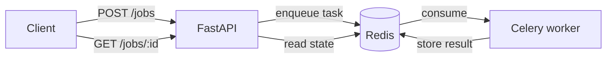

# JobFlow Service


An asynchronous job processing service built with **Python, FastAPI, Celery and Redis**. Clients submit a text for analysis and get a job id right away (`202 Accepted`); a separate worker processes it in the background and the result is fetched by polling.

## Features

- Non-blocking API: submit a job, get an id, poll for the result
- Background processing in Celery workers, scaled independently from the API
- Clear job lifecycle: `QUEUED`, `RUNNING`, `COMPLETED`, `FAILED`
- Unknown job ids return `404` (Celery alone reports them as `PENDING`)
- Input validation with Pydantic and an OpenAPI page at `/docs`
- Tests that run without Redis or a worker (Celery eager mode)
- Docker Compose with API, worker and Redis, and a GitHub Actions pipeline
- Automated dependency updates with Dependabot

## Tech stack

| Layer | Choice |
|-------|--------|
| API | FastAPI + Pydantic v2 |
| Queue and workers | Celery 5 |
| Broker and result backend | Redis 7 |
| Testing | pytest + FastAPI TestClient |
| Lint and format | ruff |
| DevOps | Docker, Docker Compose, GitHub Actions |

## Architecture



```
app/
├── main.py        # HTTP routes
├── jobs.py        # submit/read jobs and state mapping
├── tasks.py       # Celery task
├── analysis.py    # pure text analysis, no I/O
├── celery_app.py  # Celery configuration
├── schemas.py     # request and response models
└── config.py      # settings from environment variables
```

## Getting started

### Option A: Docker Compose

```bash
docker compose up --build
# API on http://localhost:8000 (docs at /docs)
```

### Option B: local development

```bash
python3 -m venv .venv && source .venv/bin/activate
pip install -r requirements-dev.txt
cp .env.example .env

docker run -d --name jobflow-redis -p 6379:6379 redis:7-alpine
celery -A app.celery_app:celery_app worker --loglevel=info   # terminal 1
uvicorn app.main:app --reload                                # terminal 2
```

### Tests

```bash
python -m pytest -q
ruff check . && ruff format --check .
```

## API reference

| Method | Endpoint | Description |
|--------|----------|-------------|
| GET | `/health` | Health check |
| POST | `/jobs` | Submit a text, returns `202` with the job id |
| GET | `/jobs/{id}` | Job status and result |

### Example

```bash
curl -X POST http://localhost:8000/jobs \
  -H "Content-Type: application/json" \
  -d '{"text":"Hello world. Hello again!","delay_seconds":5}'

curl http://localhost:8000/jobs/<ID>
```

```json
{
  "id": "44d1d236-1800-43fc-9715-b77a60478f3f",
  "status": "COMPLETED",
  "result": {
    "characters": 25,
    "words": 4,
    "unique_words": 3,
    "sentences": 2,
    "reading_time_seconds": 1,
    "top_words": [{ "word": "hello", "count": 2 }]
  },
  "error": null
}
```

`delay_seconds` (0 to 30) simulates heavy work, which makes the `RUNNING` state easy to observe.

## Design decisions

- **202 + polling** instead of holding the HTTP request open, so slow jobs never block the API.
- **Marker key written before enqueueing**: Celery returns `PENDING` for both queued and unknown ids, so a marker in the result backend lets the API return `404` for ids that never existed.
- **Pure analysis function**, separate from the Celery task, so the logic is tested without any infrastructure.
- **Eager mode in tests**: tasks run synchronously with an in-memory backend, keeping the suite fast and dependency-free.
- **`acks_late` and a soft time limit** so a crashed worker does not lose its task and runaway jobs are interrupted.
- **Same image for API and worker**, with only the command changing.

## Roadmap

- [ ] Automatic retries with backoff for failing tasks
- [ ] Persist job history in PostgreSQL
- [ ] Authentication and rate limiting
- [ ] Webhook callback when a job finishes
- [ ] Deploy with Terraform on AWS

## License

MIT
